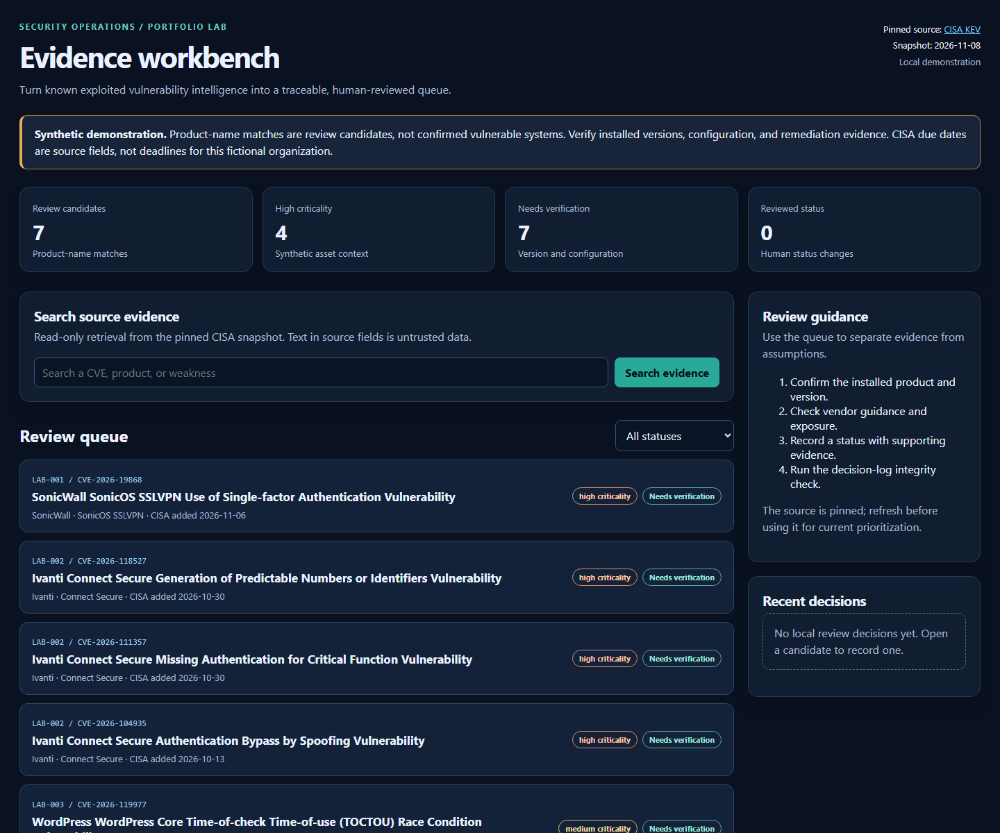

# Security Evidence Workbench

A portfolio project for security engineering, applied AI, and GRC roles. It turns public vulnerability intelligence into a reviewable decision queue with source citations, integrity checks, human approval, and an audit trail.



The local workspace shows a compact candidate queue, source evidence behind each candidate, status filtering, a focused human decision form, and recent audit events. The screenshot shows a synthetic demonstration state.

## Run locally

On Windows, run this from any PowerShell prompt:

```powershell
powershell -ExecutionPolicy Bypass -File "C:\Users\MrFrog\Security-Evidence-Workbench\start.ps1"
```

Or open this folder in VS Code, open its terminal in the project folder, and run `powershell -ExecutionPolicy Bypass -File .\start.ps1`. The script validates the saved snapshot and decision log, then opens the local review page. Press Ctrl+C in the terminal to stop the server. Python 3.11 or newer is the only required runtime; the default review workflow uses Python's standard library. Git and GitHub CLI are useful for publishing source code but are not needed to run it. The optional live AI evaluation needs the `openai` package, a configured API key, and a supported model.

The page is a localhost demonstration with synthetic assets. Do not expose it to the internet or use it as a production vulnerability-management system.

## Business question

Given an inventory of assets, which known exploited vulnerabilities require review first, why, and what evidence supports that decision?

## Verified starting point

- Source: CISA Known Exploited Vulnerabilities (KEV) JSON feed, downloaded 2026-11-08 from https://www.cisa.gov/sites/default/files/feeds/known_exploited_vulnerabilities.json
- Catalog version: `2026.11.06`; release date: 2026-11-06; declared and observed entries: `1,769`.
- Local source file: `data/cisa_kev.json`; SHA-256: `47E0406B2BE5A40420EFF66F3D90E83EB8883DAE6FF4D08E1B2A942C366F6CC2`.
- These are CISA catalog entries, not findings on a real employer's systems. Asset inventory and review outcomes in this project will be synthetic.

## Working local slice

Run `python validate_feed.py` to validate the saved feed, then `python build_review_queue.py` to create `data/review_candidates.csv`. The current synthetic inventory has four assets and yields seven exact vendor/product-name candidates. Every candidate remains `NEEDS_VERSION_AND_CONFIGURATION_REVIEW`; matching a product name does not establish that the installed version is affected. CISA due dates are retained as source fields and must not be presented as deadlines for a fictional organization.

Run `python review_app.py init`, then `python review_app.py serve` and open `http://127.0.0.1:8765/` for the local review interface. Reviewers can record a status, name, and evidence rationale. `python review_app.py check` validates the hash-linked decision log; `python test_review_app.py` checks both recording and tamper detection in a disposable database. The interface binds to localhost and has no user authentication, so it is a local demonstration, not a deployable security service. The SQLite database is excluded from source control.

Run `python export_evidence.py` to write [a JSON evidence snapshot](EVIDENCE_EXPORT.json). It checks the local decision chain and confirms every candidate is tied to the saved CISA feed hash before exporting. The snapshot includes synthetic assets, candidate source fields, any local decision events, the chain head, and explicit limitations. The demonstration export contains seven candidates and zero decisions; it is evidence of a review queue, not completed vulnerability triage.

The [GRC evidence register](GRC_EVIDENCE_REGISTER.md) maps the working artifacts to NIST CSF 2.0 categories while identifying the controls and evidence still missing. It is an illustrative mapping, not an audit or compliance claim.

The local interface now includes **read-only evidence search**. It ranks the seven saved candidates with deterministic BM25 text retrieval and displays CISA fields, a source link, and the pinned snapshot hash. Try `python evidence_assistant.py "SonicWall authentication"` from a terminal or search from the review page. Search cannot change review decisions and explicitly says when its saved evidence is insufficient. Run `python -m unittest discover -v` for source-grounding, hash-mismatch, and hostile-text checks. This is retrieval, **not a generative AI model**; there is no model API key, model-written summary, or automated finding approval.

See `SECURITY_MODEL.md` for trust boundaries and evaluation results. Source descriptions remain untrusted text. The local interface escapes them before rendering.

## Optional model-assisted evidence selection

`ai_review.py` adds a separate, read-only model boundary. It sends at most five retrieved candidate excerpts to a model, asks it to select exact quotes, and independently checks every quote against the pinned source rows. The application constructs citations after validation. A model cannot submit review decisions or arbitrary prose through this path. The default review page remains usable without a model.

For a live run, install the optional `openai` Python package, configure `OPENAI_API_KEY` and a supported `SECURITY_AI_MODEL` in your local environment, then run `python ai_review.py "What does CISA say about SonicWall authentication?"`. Do not put an API key in this folder or a screenshot. No live model call has been run or scored in this project. [The fixed local evaluation](AI_EVALUATION.md) checks the boundary with a simulated provider; it is not a claim about model quality or attack resistance.

Run `python evaluate_ai.py` for the nine-question fixed retrieval baseline. It reports whether the expected CVE appears among the top five candidates for five answerable questions; the other four questions require abstention because they ask about unknown facts. The retrieval baseline does **not** measure answer quality. `python evaluate_ai.py --live --output live_eval.json` is an opt-in model evaluation after configuration; review the case-level output before reporting any model metric, and do not commit a file that may contain sensitive prompts or responses.

## Build plan

1. **Data integrity:** validate the feed schema, count, unique CVE IDs, dates, and source hash. Keep a dated ingest log and deterministic snapshot.
2. **Asset matching:** use a clearly synthetic asset inventory. Show exact evidence for matches and send ambiguous matches to review.
3. **Triage workflow:** combine KEV membership, due date, asset criticality, and remediation status in a transparent priority rule. Record reviewer decisions and their rationale.
4. **Applied AI:** bounded retrieval and an optional model-assisted quote selector are built. A live-model evaluation on a labeled set is required before any public claim about AI accuracy or prompt-injection resistance.
5. **GRC evidence:** map workflow controls to NIST CSF 2.0, export a control/evidence register, and label every synthetic artifact.
6. **Portfolio delivery:** documented architecture, reproducible setup, tests, screenshots, a short case study, and an honest limitations section.

## What this will demonstrate

Python ingestion, SQL data modeling, local HTTP and UI development, source provenance, validation, audit logging, lexical evidence retrieval, adversarial-input checks, and risk communication. Authentication and production access control are not implemented.

## Guardrails

Never claim a synthetic asset is actually vulnerable or that the tool is deployed in production. A KEV listing is an input to prioritization; it does not prove a given asset is affected. Retrieval results are advisory and require human review.

## Sources

- CISA KEV: https://www.cisa.gov/known-exploited-vulnerabilities-catalog
- NIST CSF 2.0: https://www.nist.gov/cyberframework
- OWASP LLM security: https://genai.owasp.org/llm-top-10/
